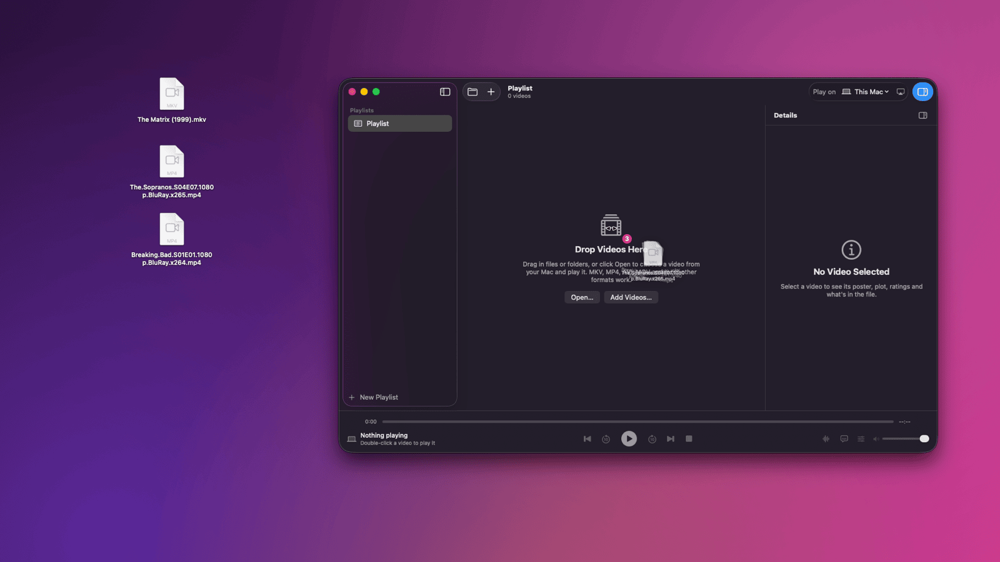
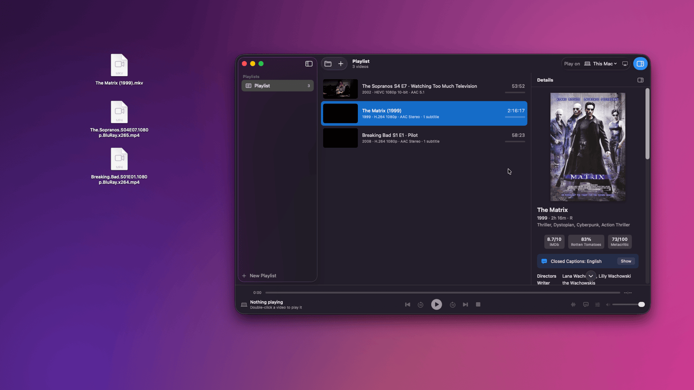
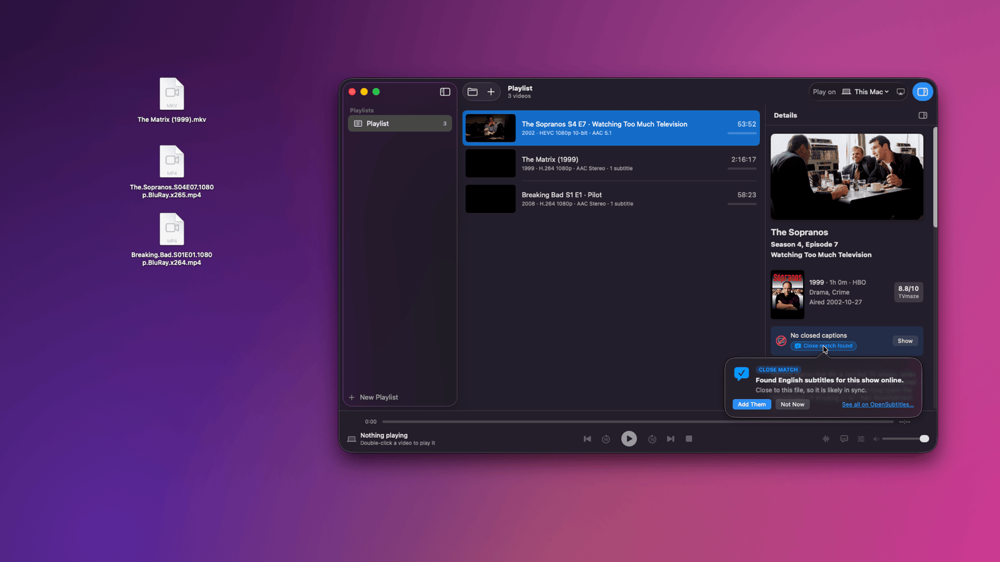
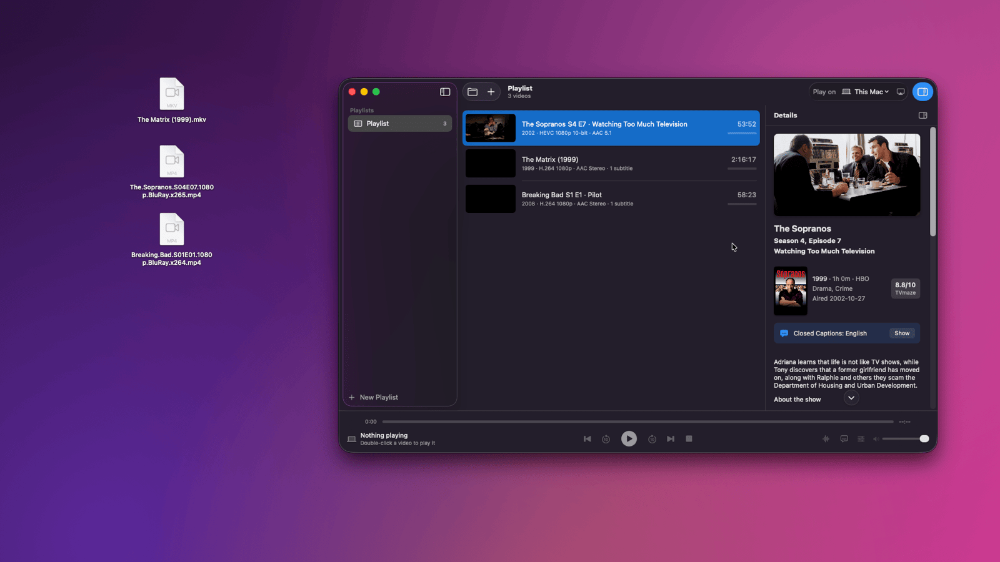
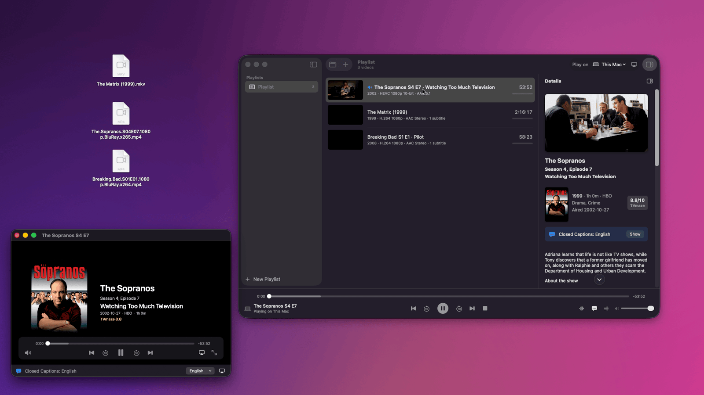
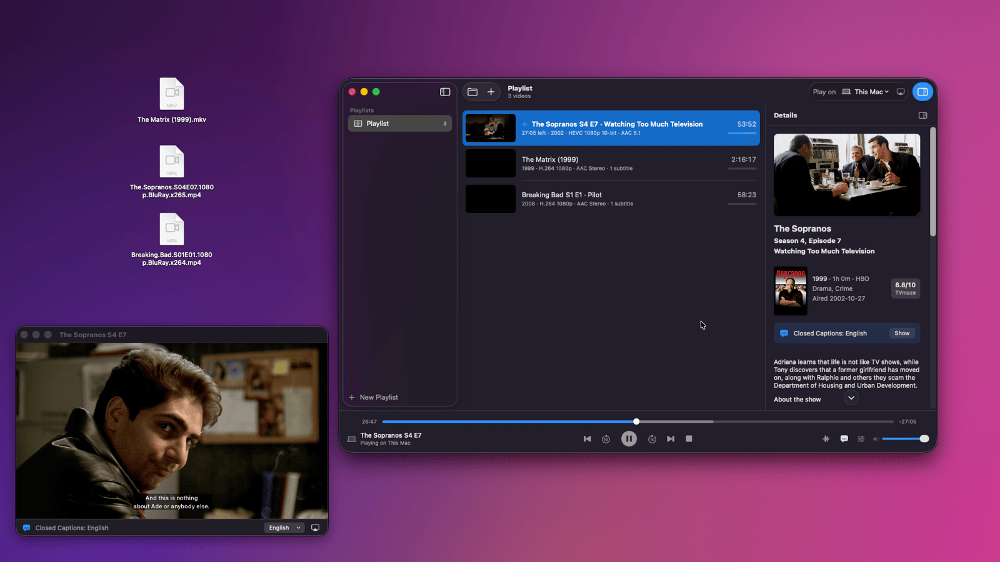
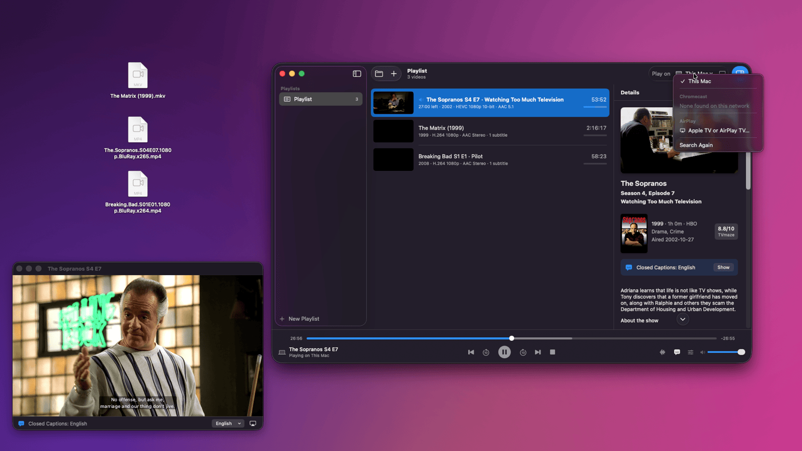
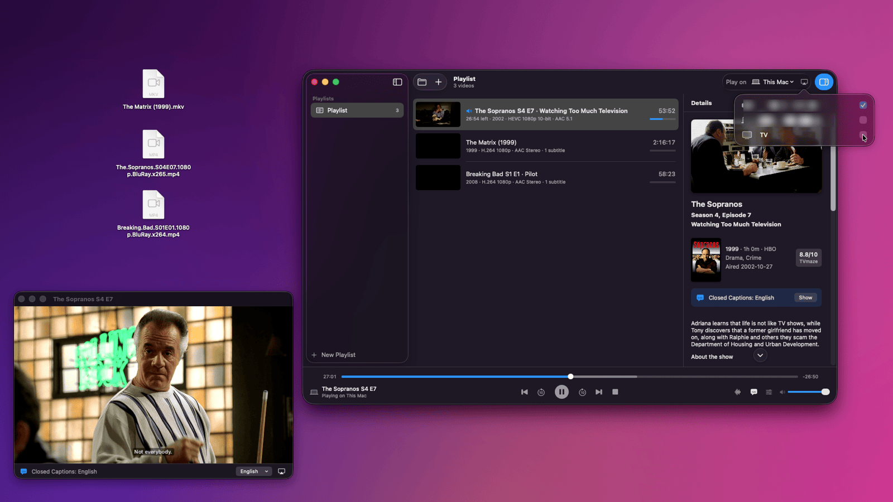
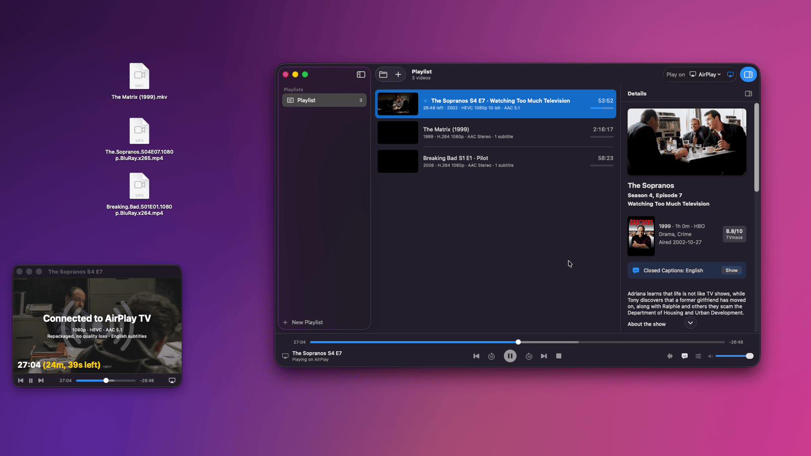

 <small>Free disk image for macOS 13 or later, Apple silicon and Intel · <a href="https://github.com/leechsoftware/driftcast/releases">All releases</a></small>

**Nearly any video on your Mac, on the biggest screen in the house.** Chromecast, Apple TV and AirPlay 2 TVs, with no waiting and no conversion it doesn't need. Driftcast streams MKV, AVI, WMV, TS and nearly any other video file, converting only what the device can't play.

Driftcast is a free, open-source Mac app from Leech Software. It is the free alternative to Airflow, Beamer, Elmedia Player, JustStream, Infuse and Plex for playing the video files on your Mac on the TV.

<a href="https://github.com/leechsoftware/driftcast/releases/latest"><strong>Download the latest version</strong></a> · <a href="https://github.com/leechsoftware/driftcast">Source code on GitHub</a> · <a href="https://github.com/leechsoftware/driftcast/blob/main/docs/DESCRIPTION.md">Everything it does, in detail</a> · <a href="https://github.com/leechsoftware/driftcast/blob/main/PRIVACY.md">Privacy</a>

macOS 13 Ventura or later, Apple silicon and Intel. Free, under the GNU GPL v3. No account, no trial, no ads, no tracking.

<video controls preload="metadata" poster="images/steps/6-playing-with-subtitles.png" width="100%" src="media/driftcast-demo.mp4">Your browser can't play this video. <a href="media/driftcast-demo.mp4">Download it</a>.</video>

<small>The demo, with narration: drop in videos, see a poster and details, add subtitles found online, play, and send it to a TV with AirPlay.</small>

## Screenshots

<figure style="margin:0"><figcaption><small>1. Drop in movies and shows</small></figcaption></figure>
<figure style="margin:0"><figcaption><small>2. A movie's poster and details</small></figcaption></figure>
<figure style="margin:0"><figcaption><small>3. Subtitles found online</small></figcaption></figure>
<figure style="margin:0"><figcaption><small>4. Subtitles added</small></figcaption></figure>
<figure style="margin:0"><figcaption><small>5. A title card as it starts</small></figcaption></figure>
<figure style="margin:0"><figcaption><small>6. Playing, with subtitles</small></figcaption></figure>
<figure style="margin:0"><figcaption><small>7. Choose where to play</small></figcaption></figure>
<figure style="margin:0"><figcaption><small>8. Pick your TV</small></figcaption></figure>
<figure style="margin:0"><figcaption><small>9. Playing on the TV</small></figcaption></figure>

<small>The Sopranos, The Matrix and Breaking Bad, with their posters and artwork, belong to their owners and are shown only to demonstrate the app.</small>

## Why Driftcast

- **Plays nearly anything:** MKV, MP4, MOV, AVI, WMV, WebM, TS, M2TS, VOB, MPEG, FLV, DivX, RMVB, MXF and more. H.264, HEVC, AV1, VP9, VP8, MPEG-2, VC-1, ProRes, HDR10, HLG and Dolby Vision. Dolby Atmos, E-AC-3, AC-3, DTS-HD, TrueHD, FLAC, ALAC, AAC and Opus.
- **Converts only what it must:** a file the device can play is sent untouched. When only the container is wrong, the streams are repackaged with no quality loss. Only a stream the device can't decode is converted, while you watch.
- **Runs on the GPU:** decoding, scaling, HDR tone mapping and H.264 encoding stay in VideoToolbox, about a thirtieth of the CPU time of a software conversion.
- **Real seeking:** the device receives the complete playlist before conversion starts, so it shows the true duration and the TV remote can skip and scrub.
- **Every Chromecast:** 1st to 3rd generation, Chromecast HD, Ultra, Chromecast with Google TV, Google TV Streamer, Nest Hub and TVs with Chromecast built in, each getting exactly what it can play. Google speakers get the sound.
- **Apple TV and AirPlay 2 TVs** from Samsung, LG, Sony, Roku, Vizio, Hisense and others, with HEVC, HDR and Dolby audio passed through.
- **Subtitles done properly:** text tracks in any encoding, subtitle files found beside the video, Blu-ray PGS and DVD VobSub read into text on your Mac, and a built-in OpenSubtitles search that downloads and turns a subtitle on in one step.
- **Film and show details:** poster, plot, cast, director, genres, age rating and IMDb, Rotten Tomatoes and Metacritic scores, with no account.
- **A title card** with the poster before the film starts, playlists, resume, watched marks, preview frames on the timeline, media keys, and every control in a menu.
- **Updates itself,** checking that each new version is signed by Leech Software before it is installed.

## Get it

1. [Download the latest release](https://github.com/leechsoftware/driftcast/releases/latest) and open the disk image.
2. Drag Driftcast to your Applications folder.
3. Open it, drop a video on the window, and pick your TV.

Release builds are signed with a Developer ID and notarized by Apple. The source code, build scripts and automated checks are all on [GitHub](https://github.com/leechsoftware/driftcast); changes are welcome.

## Guides

- [How to cast MKV files to Chromecast from a Mac]({{ '/how-to-cast-mkv-to-chromecast-from-mac/' | relative_url }})
- [How to play MKV files on Apple TV from a Mac]({{ '/play-mkv-on-apple-tv-from-mac/' | relative_url }})
- [How to send any video from a Mac to a Samsung or LG TV]({{ '/airplay-video-from-mac-to-samsung-lg-tv/' | relative_url }})
- [How to get subtitles on Chromecast from a Mac]({{ '/chromecast-subtitles-from-mac/' | relative_url }})
- [How to play DTS audio on Chromecast from a Mac]({{ '/dts-audio-chromecast-mac/' | relative_url }})
- [How to cast 4K HDR video from a Mac]({{ '/cast-4k-hdr-video-from-mac/' | relative_url }})
- [A free Airflow alternative for Mac]({{ '/free-airflow-alternative-for-mac/' | relative_url }})

## Supported macOS versions and Macs

| macOS | Apple silicon | Intel |
|---|:-:|:-:|
| macOS 26 Tahoe | ✓ | ✓ |
| macOS 15 Sequoia | ✓ | ✓ |
| macOS 14 Sonoma | ✓ | ✓ |
| macOS 13 Ventura | ✓ | ✓ |

One universal app, with FFmpeg already inside it. Nothing else to install.

---

Copyright © 2026 [Leech Software, Inc.](https://leechsoftware.com) Driftcast is free software under the GNU General Public License v3 or later. Chromecast, Google TV, Apple TV, AirPlay, macOS, Dolby and DTS are trademarks of their owners; Driftcast is not affiliated with or endorsed by any of them.
